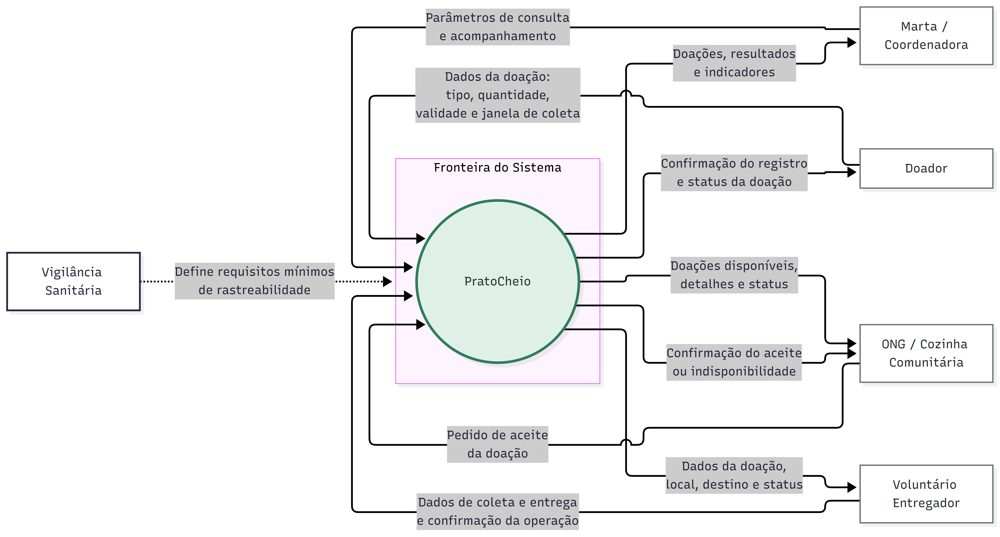

- **Pergunta:** quem troca informação com o Prato Cheio, e o quê, na fronteira do piloto?
- **Decisão que sustenta:** decisões 1 e 3 (aceite exclusivo pela ONG; dados mínimos exigidos pela Vigilância Sanitária).
- **Situação:** proposta. Na `main` do commit `56beff4`, o código implementa os fluxos do Doador e da ONG; da Marta, só o histórico de doações aceitas (sem indicadores nem parâmetros de consulta); os fluxos do Voluntário entregador ainda não existem.

# Diagrama de contexto — Prato Cheio

6 elementos. Todas as setas têm rótulo. A Vigilância Sanitária define os requisitos mínimos de rastreabilidade.