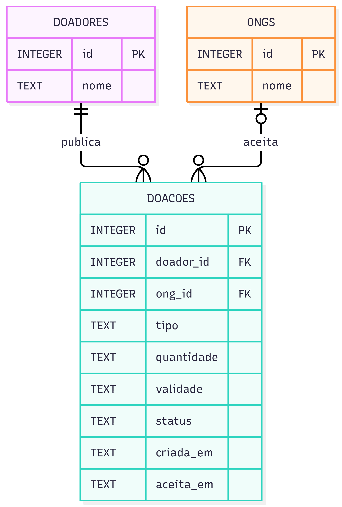

- **Pergunta:** que dados o Prato Cheio precisa guardar para que uma doação seja publicada, aceita por uma única ONG e rastreada?
- **Decisão que sustenta:** decisões 1 e 3 e o ADR 0001 (migração para PostgreSQL na Unidade 3).
- **Situação:** proposta (modelo-alvo). Difere de `src/db.js` nos três pontos abaixo.

# Modelo de dados — Prato Cheio

3 elementos. Relações rotuladas: um doador **publica** doações; uma ONG **aceita** doações.

## Divergências em relação a `src/db.js`

1. **`DOADORES` e `doador_id`:** previstos no diagrama; no código atual, a doação ainda não registra o doador.
2. **`ONGS`:** prevista no diagrama; no código atual, não há cadastro de ONGs.
3. **Referência à ONG:** no diagrama é `ong_id` (INTEGER, FK para `ONGS`); no código atual é `ong TEXT`, com o nome informado no aceite.

Essas diferenças são intencionais: o cadastro de doadores e de ONGs (e a autenticação) ficou fora da História Zero. O diagrama mostra o modelo-alvo; essas tabelas só entram quando essas histórias forem priorizadas.